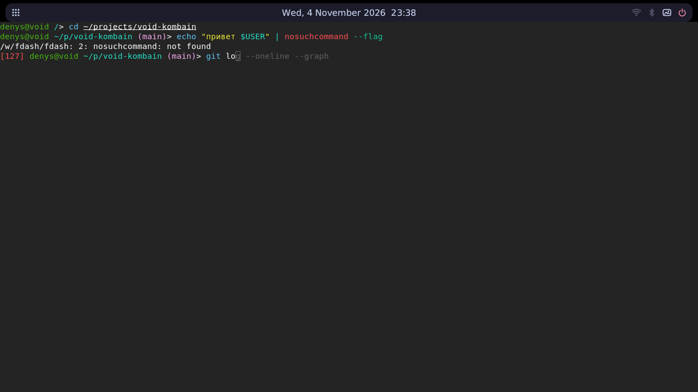

# kombain

A fast, small and hardened Void Linux desktop for developers and gamers. Every
layer is picked by what it really adds to the system, measured from the Void
package index.



*fdash in foot under netline, captured on sway with software rendering. mango itself
is tested in a VM, see Status below.*

## The stack

"Adds" is the installed size a package pulls in on top of `base-system` with
mango, dependencies included, from the Void x86_64 index in November 2026.

| Layer | Pick | Adds | Instead of |
|---|---|---|---|
| Scripts | dash (`/bin/sh`) | already there | bash |
| Interactive shell | [fdash](fdash/) | 0.4 MiB | fish (19.3 MiB) |
| Prompt, history | built into fdash | 0 | starship (12 MiB), atuin (28 MiB) |
| Compositor | mangowc | 53.5 MiB, libraries included | |
| Panel, launcher, sound, brightness, battery, Wi-Fi, Bluetooth, wallpaper, power, calendar | [netline](https://github.com/FalconBinary/netline) | 1.7 MiB | waybar, rofi, swaybg, nmcli, pavucontrol |
| Terminal | foot, as a server | 1 MiB | alacritty (8.6 MiB), kitty (80.5 MiB) |
| Screen lock | swaylock | 0.1 MiB | |
| Firewall | nftables, loaded before the network | 25.4 MiB | |
| Temperatures | [zcool](zcool/): a limit per chip, CPU and every GPU, fans first, then a little power; learns what the cooler carries; turbo, energy preference, quiet fans and lower limits on battery; the EC's silent fan curve when cool; the CPU's short-term power limit and its own throttle just above the limit; jobs yield the CPU to the desktop and a memory hog is ended before a freeze; `zcool menu` for every setting; a GPU that shows nothing sleeps when idle | 0.2 MiB, 0.2 MiB more with NVIDIA's driver | |
| Search | ripgrep, fd, fzf, jq | 15.3 MiB | |
| Multiplexer | tmux | 1.6 MiB | zellij (49.3 MiB) |
| Files | nnn | 0.4 MiB | yazi (41.2 MiB) |
| Processes | htop | 0.4 MiB | btop (1.9 MiB) |
| Version control | git | 129.6 MiB | |

With `--extras`, because they only pay off when used: neovim (35.5 MiB, helix is
207.2 MiB), ccache (2 MiB), mold (49.4 MiB). Left out for the same reason: podman
(219.7 MiB).

## Install

To install the whole system from the Void live ISO (LUKS, XFS, Limine, iwd, a separate
gaming mode), `./setup.sh` asks for the disk and the sizes of `/`, the games and your files, erases the
disk once you type its name, and installs everything below too. It runs the commands of
[docs/void-install-guide.md](docs/void-install-guide.md), where the same steps can be done by hand.
`--dry-run` shows the commands and changes nothing.

On an existing Void Linux with glibc, as root:

```sh
git clone https://github.com/FalconBinary/kombain
cd kombain
./install.sh --user NAME
chsh -s /usr/local/bin/fdash NAME
```

Then log in on tty1. It is safe to run again: `/bin/sh` stays dash, and existing
dotfiles and `/etc/nftables.conf` are kept. It also enables the `dbus` and `elogind`
services. The firewall starts right away and drops new incoming connections, so if
you reach this machine over ssh, open port 22 first (the script warns about it).

It also installs the kernel hardening settings in `config/sysctl.conf`. They take
effect right away, and some cannot be undone until a reboot. That includes
`kernel.yama.ptrace_scope=1`, so attaching a debugger to a running process needs root.
Kernel lockdown is set in the bootloader, so the script only reminds you about it.
fdash, netline and zcool are built as `nobody`, and netline is pinned to one commit.

It also builds the gconv cache that Void's glibc lacks and refreshes it at every
boot. In our measurements that made programs under a UTF-8 locale start about
twice as fast (`bash -c true`: 1.11 ms to 0.50 ms). Void's zig is too old for netline
and zcool, so the script fetches a checksummed Zig 0.17.1 for the build and removes it
afterwards.

| Keys | Action |
|---|---|
| `Alt+Return` | Terminal |
| `Super+D`, `Alt+Space` | Applications |
| `Super+Shift+R` | Run a command |
| `Super+W`, `Super+B` | Wi-Fi, Bluetooth |
| `Super+P` | Wallpaper |
| `Super+C` | Calendar |
| `Super+Escape` | Power menu |
| `Alt+Shift` | Switch between us and ru |

## What it uses

Measured in a VM, on the same machine and by the same script (`tests/vm/install.py`, see the
workflow), with nothing running. A plain Void install is base-system with what void-installer
enables, on the same kernel. It has no encryption, no firewall and no desktop.

| Idle, at the console | Plain Void | kombain |
|---|---|---|
| Memory in use | 251 MiB | 291 MiB |
| Processes | 29 | 34 |
| Context switches per second | 98 | 72 |
| Interrupts per second | 163 | 112 |
| Written to disk in 30 s | 792 KiB | 0 |
| Files on `/`, without the package cache | 1166 MiB | 1759 MiB |

kombain has more installed at this point: 366 packages against 140, among them Flatpak and gamescope for Steam.
Of its 40 MiB of extra memory, 9 MiB are processes and 12 MiB kernel slab, and the rest wasn't broken down:
it also runs encryption and LVM, which plain Void here doesn't.

| Idle, on the desktop with one terminal open | Before tuning | Now |
|---|---|---|
| Memory in use | 486 MiB | 442-453 MiB |
| Sum of process memory (RSS) | 419 MiB | 282-283 MiB |
| Processes | 63 | 48 |
| Context switches per second | 49-56 | 10-41 |
| Interrupts per second | 89-104 | 25-49 |
| Files on `/` | 3400 MiB | 2131 MiB |

The ranges are from separate runs. Wakeups differ a lot from run to run, so only the direction is firm.

Most of the desktop's memory is mango rendering in software in this VM (154 MiB): on a real GPU it will
differ. Real hardware, power draw and frame rates in games have not been measured.

Removed or put off: Xwayland (starts with an X11 program and ends with it), rtkit and polkitd at idle
(real-time rights for sound come from limits, and polkit starts only when something asks it), spare consoles, the
terminal server, WirePlumber's camera and MIDI watchers, the package cache (also cleared weekly), unused
locales, wpa_supplicant (iwd does Wi-Fi and its addresses), dhcpcd without a cable, and with `setup.sh` the
firmware of vendors the machine doesn't have and iwd without Wi-Fi.
Fewer timers: no kernel watchdog or KFENCE sampling, fewer writeback and vmstat wakeups. In Dev mode idle PCI devices may sleep,
except GPUs and USB; zcool lets a GPU that shows nothing sleep, and does not wake it. Gaming mode keeps everything at full speed.

The programs are built with `ReleaseSafe`: it keeps bounds checks, and against `ReleaseFast` it made no measurable difference
to the panel's frame time. `ReleaseSmall` was about ten times slower per frame for under 0.1 MiB of memory.

### Boot

The same VM test splits every boot into its steps. These numbers are from one run of the guide's install. The time a
prompt waits for its passphrase is left out.

| Seconds since QEMU started | Dev | Gaming | Plain Void |
|---|---|---|---|
| Firmware and Limine, its 2 s menu included | 3.4 | 3.5 | 1.2 |
| Kernel | 0.8 | 0.5 | 0.6 |
| Initramfs, until it asks for a passphrase | 0.9 | 0.9 | 1.0, all of it |
| Unlocking LUKS | 2.6 + 3.4 | 3.2 | |
| runit's stage 1 | 0.7 | 0.7 | 0.8 |
| **To the login prompt** | **12.0** | **8.9** | **3.6** |

After logging in, mango starts within 0.2 s and netline within 0.7 s.

Most of the difference is on purpose:

- **LUKS.** Each volume's key takes about 2 s to derive. cryptsetup sets argon2id with 1 GiB of memory to take
  that long on the CPU that formatted it. Dev has two volumes.
- **Limine.** Its menu waits 2 s, so Gaming can be picked.

Two things cost time for nothing, and are gone:

- **The initramfs.** dracut's default host-only mode still adds every keyboard, USB, disk and SCSI driver, with
  network cards' firmware. Its strict mode keeps this machine's drivers only: 20 MiB instead of 35.
- **btrfs.** Void's stage 1 loads every module that has a fixed device file, at every boot. btrfs spent
  0.2 s on that, most of it benchmarking RAID6 code. It is blacklisted, with four test and legacy devices; stage 1
  went from 1.2 s to 0.7 s.

Real firmware is usually slower than the VM's. `kombain-report` reads its time from the firmware's own record, when
the firmware keeps one.

## Status

CI ([workflow](.github/workflows/ci.yml)) runs all of this on x86_64:

- fdash: 69 tests through a real pty, also under ASan and UBSan, with scripts
  compared against unmodified dash of the same version.
- `install.sh`: from a clean image, twice.
- Firewall: `tests/firewall.sh` sends real traffic between network namespaces,
  including a broken config and a missing one.
- gconv cache: `tests/gconv-cache.sh`, including a stale and a damaged cache.
- zcool: unit tests and a thermal simulator, `zcool/tests/sim.py`, with AMD, Intel and
  NVIDIA GPUs; NVIDIA's library is a stand-in there.
- `setup.sh`: `tests/setup-logic.sh` checks its arithmetic and dry runs, with fake commands that
  fail if anything changing a disk is called. In a VM, on a disk with other device names,
  it is answered like a person, wrong answers first, and then gets the same checks as the guide;
  a second VM answers no to the cable and checks that dhcpcd is gone and that updates leave it out.
- The guide itself: `tests/vm/install.py` types its commands into a UEFI VM booted
  from the Void ISO, then boots the result through Limine and checks both modes:
  LUKS prompts, the Dev volume locked in Gaming, lockdown, firewall, every sysctl and
  service. It then runs `install.sh` there and starts mango from tty1 with netline
  and foot running fdash, and checks that the panel slides out at the screen edge, follows
  mango's tags, shows the state of the session's PipeWire and a battery from the kernel's test module, and that
  sound still runs in real time.
- Wi-Fi: a WPA2 access point on the kernel's radio simulator, in a network namespace of its own.
  iwd joins it with the guide's `iwctl` commands, and after `setup.sh` on its own from the network
  saved during the install; it gets an address, and netline's icon changes. Void's kernel is built
  without the simulator, so the test builds it from the kernel's source for the running version and
  boots Dev once without lockdown, which refuses unsigned modules; then it puts everything back and
  checks that the disk is the same size as before.
- Secure Boot: step 12 as written, in OVMF firmware that starts in Setup Mode. After the reboot
  Secure Boot is on and the kernel reports it, Dev still asks for both passphrases, a copy of Limine
  without the signature, which booted before step 12, is refused, and a kernel changed by one byte
  stops at Limine's hash check.

The VM differs from the guide in a few places: `sfdisk` instead of `cfdisk`, a serial
console, a wired network for the install, a simulated radio, and mango rendering in software on virtio-gpu.

Not checked yet:

- **A real machine.** Nothing has booted outside a VM or a container.
- **mango on a real GPU.**
- **gamescope and Steam.** The VM has no Vulkan device, so gamescope stops at startup.
  Only that failure is tested: the session reports it and waits instead of restarting.
- **A real Wi-Fi chip**, with its driver and firmware.
- **A real battery and backlight.** The VM has the kernel's test battery and no backlight; netline's own tests
  use a fake one in /sys, so real hardware, and elogind's path for the brightness, have not run.
- **Secure Boot on real firmware.** Option ROMs, the BIOS password and vendor menus differ from
  OVMF's.
- **Power saving on real devices.** A device that misbehaves when asleep shows up only on real hardware. To
  turn it off: `rm /etc/runit/core-services/91-power-save.sh`.
- **zcool on real sensors and fans,** and with NVIDIA's real library. Real drivers and chips differ from the model,
  so start with `--dry-run`. Undervolting has not run on any CPU.

What a real machine says about all of this, `kombain-report` collects into one file (the guide's step 14). The file shows:

- which GPU draws the screen and which runs the games;
- what sleeps;
- power and wakeups at rest;
- sensors and fans;
- whether firmware allows undervolting;
- the Secure Boot state.

The VM test runs the report on its desktop and checks it against what is there.

## Licenses

[GPL-3.0-or-later](LICENSE). The vendored code keeps its own licenses, which allow
this: [dash](fdash/dash/COPYING) is BSD-3-Clause and [isocline](fdash/isocline/LICENSE) is MIT.
